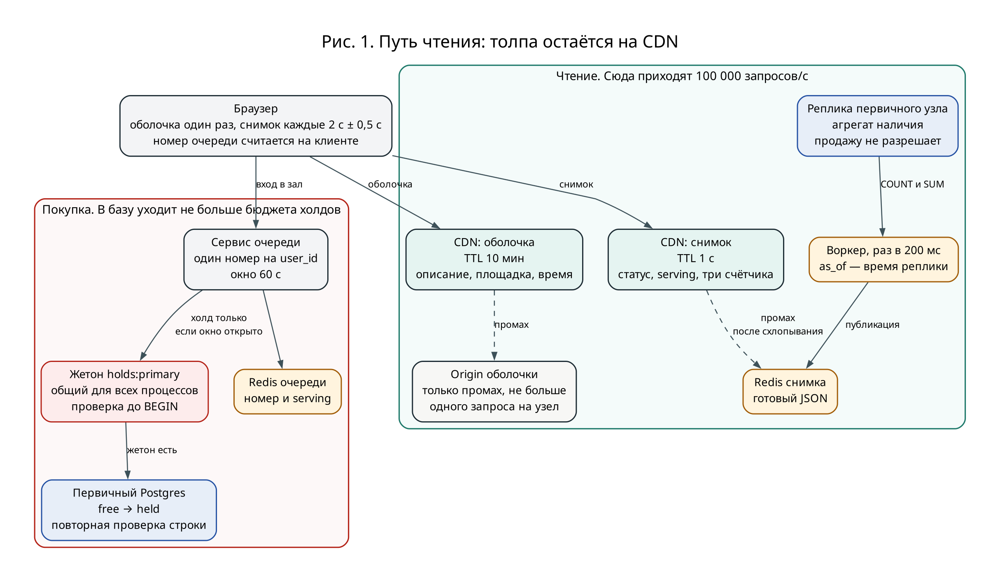
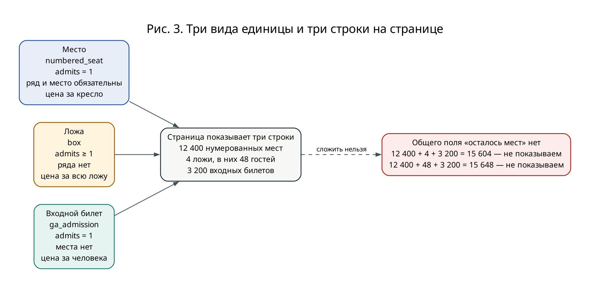
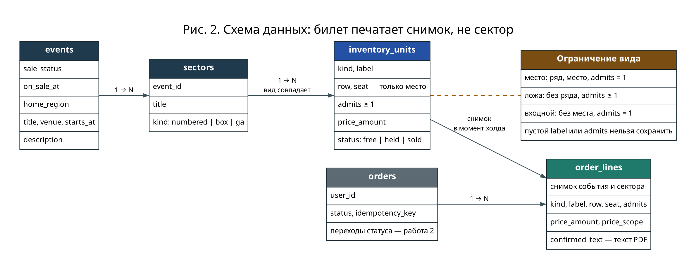
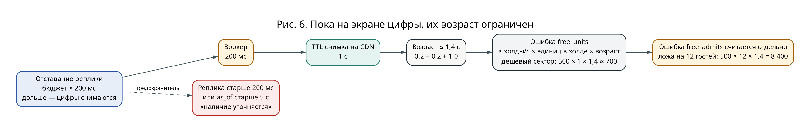
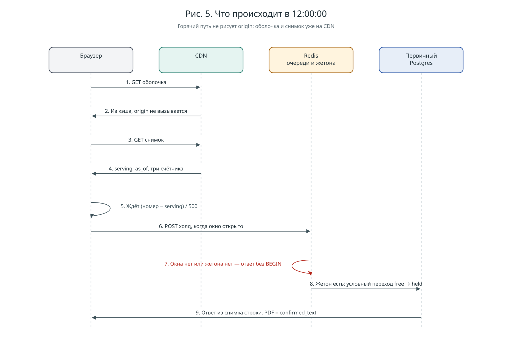
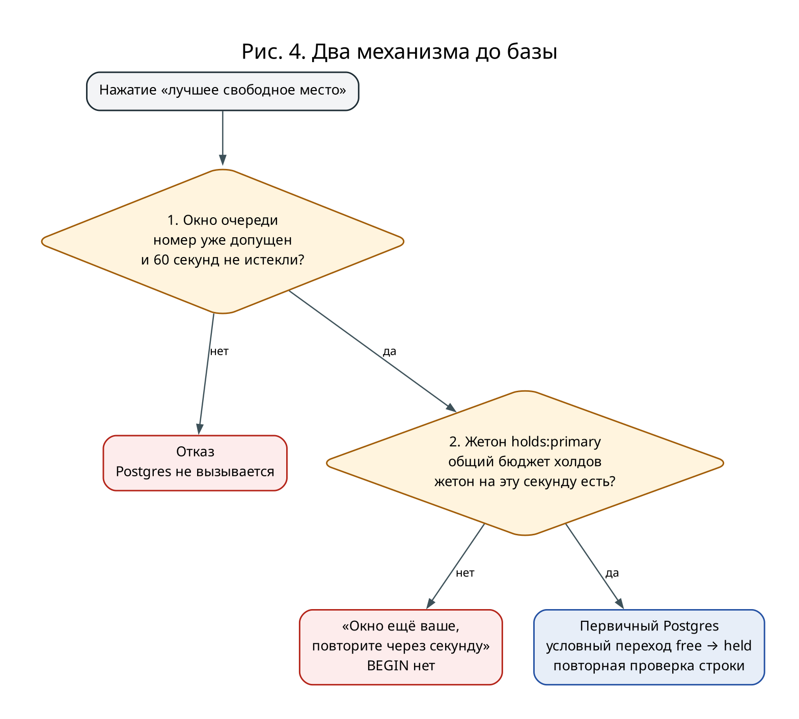

# Работа 1. Путь чтения: страница события

«Билетёр» продаёт билеты на концерты. По задаче это узкий сервис: событие, секторы, места, заказ и платёж. Похожие продукты — Ticketmaster, kassir.ru, Яндекс Афиша.

Вопрос работы такой. На странице концерта описание не менялось три месяца, а строка «осталось 43 места» устаревает за секунду. Как это кэшировать?

Ещё два пункта. Что считать единицей инвентаря, если в зале есть и кресла, и ложи, и фан-зона (1.1). Что показать человеку в 12:00:00, если всех сразу обслужить нельзя (1.2).

Ниже факты кейса отдельно от допущений. Где число не из кейса, это помечено.

## Короткий ответ

Вся страница целиком не кэшируется. Описание и счётчик живут по-разному, поэтому это два документа.

Оболочка — название, текст, площадка, время и список секторов без количеств. Её CDN держит 10 минут. Снимок — маленький JSON на 1 секунду: идут ли продажи, где голова очереди, сколько свободно в каждом секторе. Покупка этот JSON не смотрит. Место забирает только база.

Единица продажи — кресло, целая ложа или один входной билет. У ложи обязательны имя и число гостей, цена указана за всю ложу. Билет печатает фразу, которую человек подтвердил до оплаты. Собрать из неё «ложа» без гостей нельзя.

В полдень человек видит свой номер в очереди, а не ошибку. В покупку пускается 500 холдов в секунду. Отказ «зайдите позже» при 200 000 человек и повторе раз в секунду даёт 200 000 запросов на сервер. Выбран зал ожидания.

## Кейс и от чего считается нагрузка

Лето 2026, Санкт-Петербург, два концерта, стадион до 80 000. Цены от 9 000 ₽ до 160 000 ₽ за VIP-ложу. Дешёвые билеты ушли за минуты, сайт лёг на старте.

Отдельная поломка: билет с надписью «ложа», без мест и без числа гостей. Поддержка говорила, что 160 000 ₽ — цена за всю ложу, потом организаторы сказали «один билет — один человек». Так получилось больше чем у 60 человек. Места в ложе выбрать было нельзя.

Повторная оплата, отмена уже оплаченной брони, долгая выдача билета, возврат и кнопка «продажи приостановлены» в эту работу не входят.

RPS, конверсии и длины очереди в источниках нет. Дальше допущения. Счёт идёт не на спокойный день, а на старт, на котором сайт и падает.

| | Допущение | Зачем |
| --- | --- | --- |
| A1 | 40 000 дешёвых мест, половина зала | Сектор, который уходит за минуты |
| A2 | Эти места уходят за 80 с: 40 000 / 500 | Получается из лимита впуска |
| A3 | В 12:00 в очереди уже 200 000 человек | Иначе толпы нет и сайт не падает |
| A4 | Вкладка спрашивает снимок раз в 2 с, плюс случайные 0–500 мс | Чтобы все не проснулись в одну миллисекунду |
| A5 | У CDN 20 узлов | Чтобы посчитать промахи, не привязка к вендору |
| A6 | Оболочка около 80 КБ, снимок около 2 КБ | HTML тяжёлый, JSON маленький |
| A7 | Холд в среднем 4 мс, 20 соединений, запас 0,4 | Оценка потолка базы до замера |
| A8 | 2% просмотров кончаются холдом, если очереди нет | Нижняя оценка чтения |

Чтение снимка:

```text
200 000 / 2 с = 100 000 запросов/с
```

Если лишнего спроса нет, чтобы продать 40 000 мест, нужно 2 000 000 просмотров за те же 80 секунд:

```text
40 000 / 0,02 = 2 000 000
2 000 000 / 80 с = 25 000 запросов/с
```

25 000 запросов/с — спокойная распродажа. Кейс про обвал, поэтому страница должна жить при 100 000.

Оболочку люди открывают один раз. Если половина из 200 000 сделает это в последние 10 секунд, пик около 10 000 запросов/с. На случай, если все начнут обновлять сам HTML, бюджет оболочки — те же 100 000.

Два концерта стартуют в одну секунду. У каждого свой снимок и своя очередь. Лимит записи общий. Если второй концерт такой же горячий и к нему пришли ещё 200 000 человек (кейс этого не говорит, это отдельное допущение), чтение снимка становится 200 000 запросов/с, промахи в Redis — 40 в секунду, холды — до 1 000 в секунду. 40 чтений Redis ерунда. 1 000 холдов — уже половина потолка базы, поэтому лимиты двух концертов лежат в одном счётчике. Если те же 200 000 человек просто разделились на два концерта, чтение остаётся около 100 000 запросов/с.

Потолок записи не измерен. Это арифметика из A7:

```text
20 соединений × (1 / 0,004 с) = 5 000 транзакций/с
5 000 × 0,4 = 2 000 транзакций/с
```

0,4 — запас на журнал, реплику и чтение схемы зала с того же узла. Лимит — 500 принятых холдов в секунду на концерт, четверть потолка. «Принятый» — запрос, который дошёл до базы, а не успешная продажа: часть проиграет гонку за место. Два старта вместе дают до 1 000 холдов/с.

Если база отвечает дольше 100 мс в 99-м перцентиле, лимит каждого открытого концерта делится пополам. Если быстрее 20 мс дольше 10 секунд, общий лимит растёт на 10% за шаг и упирается в 1 000 холдов/с на оба концерта. Пока замера нет, от слишком смелого лимита спасают именно это, общий жетон до транзакции и повторная проверка строки в базе.

## Как устроена страница



Зелёная часть — чтение. 100 000 запросов в секунду остаются на CDN. Красная — покупка. До базы доходит только тот, у кого уже открыто окно очереди и есть жетон на эту секунду. Пунктир — редкий промах, не основной путь.

Реплика и первичный узел — один кластер Postgres, не две базы. Оболочка при промахе читает строку события. Воркер считает остатки по реплике. Холд пишет в первичный узел.

Номер очереди в общую страницу не входит. Иначе страница стала бы личной, и CDN не смог бы отдать её всем.

## 1.1 Что продаётся

Билет «ложа» без мест получается, если продавать название сектора, а поля ряда и места оставлять пустыми. Тогда 160 000 ₽ можно понять и как цену ложи, и как цену одного человека. В модели остаётся тот смысл, который человек увидел до оплаты.

Продаётся одна строка. Вид строки говорит, какие поля обязательны.

| Вид | Что покупают | Гостей | Ряд и место | Цена |
| --- | --- | --- | --- | --- |
| Место | Одно кресло | всегда 1 | обязательны | за кресло |
| Ложа | Ложа целиком | обязательно, хотя бы 1 | пусто, внутри ложи места не выбирают | за всю ложу |
| Входной | Один вход в фан-зону | всегда 1 | пусто | за человека |

У сектора тот же вид, что у его строк: в фан-зоне не лежит ложа. Цены и вместимости на секторе нет. Одна цифра вместимости не может быть сразу и числом покупок, и числом людей.

Сколько можно купить — это число строк. Сколько людей пройдёт — сумма гостей по этим строкам. Десять лож по 12 гостей — 10 покупок и 120 человек. «Стадион на 80 000» сверяется со второй цифрой, билеты — с первой.

Пустую строку сохранить нельзя. У места есть ряд, место и ровно 1 гость. У ложи нет ряда и гостей хотя бы один. У входного нет места и ровно 1 гость. У всех есть имя и цена больше нуля. Имя — не название сектора, а сама единица: «Ложа A-3», «Ряд 14, место 8».

Пример зала, это не замер:

| Сектор | Свободно купить | Свободно людей | Цена |
| --- | --- | --- | --- |
| Верхний ярус | 12 400 мест | 12 400 | 9 000 ₽ за место |
| VIP-ложи | 4 ложи | 48 (4 × 12) | 160 000 ₽ за ложу |
| Фан-зона | 3 200 входных | 3 200 | 9 000 ₽ за человека |



На странице три строки, а не одно «осталось». Складывать их нельзя.

```text
12 400 + 4 + 3 200 = 15 604
```

Здесь места смешаны с ложами. Четыре ложи — это четыре покупки, не четыре человека.

```text
12 400 + 48 + 3 200 = 15 648
```

Здесь уже люди, но по цифре не понять, можно ли купить ложу. В снимке такого поля нет. У каждого сектора три числа: сколько единиц свободно, сколько в них гостей и цена «от».

### Что попадает в билет

В момент холда единица копируется в строку заказа. Билет, письмо и поддержка читают только её. Сектор больше не открывают: если через месяц сектор переименуют, старый билет не изменится.

В копии лежат название события, время, площадка, сектор, вид, имя единицы, ряд, место, число гостей, сумма, валюта и пометка, за что цена: за человека или за всю ложу. Плюс готовая фраза. Её человек видит на кнопке до оплаты:

```text
Ложа A-3, сектор VIP-ложи, 12 гостей, 160 000 ₽ за всю ложу
Верхний ярус, ряд 14, место 8, 1 человек, 9 000 ₽ за место
Фан-зона, входной билет, 1 человек, 9 000 ₽
```

PDF печатает эту фразу как есть. Пустое имя, пустое число гостей или пустой текст не сохраняются. Пути «напечатать сектор, остальное прочерками» нет.

Если потом скажут «один билет — один человек», уже проданную ложу это само не перепишет. В снимке уже стоит, за что взяли 160 000 ₽ и сколько гостей входит.



Заказ ссылается на копию, не на живой сектор. Статусы заказа и платежа здесь не расписаны. Колонка «чей будущий заказ» на единице только намечает владельца. Правило «проданный билет принадлежит одному заказу» обеспечивает уже запись в базу, не чтение страницы.

Другие варианты отброшены.

Оставить как было: пустые ряд и место и приписка «ложа». Приписку можно забыть, число гостей положить некуда, цена сектора и цена билета живут в двух местах. Это и есть билет из кейса.

Три таблицы — места, ложи, фан-зона. Проверки проще, но страницу надо собирать из трёх запросов, а билету всё равно нужен один набор полей. На 80 000 единиц хватает одной таблицы.

Счётчик фан-зоны без строки на каждый билет. Так дешевле, если билетов миллион, но у билета нет своего владельца, и два покупателя могут списать один и тот же остаток. Здесь входных около 10 000, проще завести строку на каждый.

## Кэш

| Что | Где лежит | Как долго | Когда обновить |
| --- | --- | --- | --- |
| Оболочка: текст, время, секторы без чисел, картинка зала без занятых мест | CDN | 10 минут | Редактор опубликовал правку |
| Снимок: статус, время данных, очередь, остатки и цена «от» | CDN | 1 секунда | Сам протухает. Ещё сброс, когда сектор впервые дошёл до нуля |
| Номер человека | Redis, привязан к учётке | До конца его продажи | Повторный заход отдаёт тот же номер |

Статус «продажи открыты» лежит в снимке, не в оболочке. Иначе после полудня кнопка ждала бы до 10 минут. Часы в браузере продажи не открывают. Сервис очереди смотрит серверное время.

Оболочка:

```text
Cache-Control: public, max-age=600, stale-if-error=86400
```

Её прогревают до старта. Горячее окно длится 80 секунд, а кэш — 10 минут, поэтому внутри окна промахов нет. Раз в 10 минут узлы берут оболочку заново. Промахи схлопываются: один запрос на узел, при 20 узлах около 20 запросов, каждый читает одну строку. Если origin упал, CDN ещё сутки отдаёт старый текст. Описание и так не менялось месяцами. Счётчики при этом живут отдельно и не пропадают.

Снимок:

```text
Cache-Control: public, max-age=1, stale-if-error=5
```

На снимке всегда есть время, на которое он посчитан. Страница показывает «данные на 12:00:01», а не голую цифру.

Попадание в кэш, если каждый узел ходит за снимком один раз в секунду:

```text
промахи = 20 × 1 = 20 запросов/с
доля попаданий = 1 − 20 / 100 000 = 99,98%
```

Эти 20 — обращения к Redis, не поток от браузеров. Браузеров по-прежнему 100 000 в секунду. Цифра верна только пока узел не пускает толпу промахов пачкой, а делает один запрос и раздаёт ответ остальным. Случайные 0–500 мс к опросу нужны, чтобы раз в две секунды на CDN не прилетали все 200 000 разом.

Промах читает готовый JSON из Redis. Зал в этот момент никто не пересчитывает, Postgres для чтения страницы не открывается.

JSON кладёт воркер. Раз в 200 мс он на реплике группирует свободные строки по сектору: сколько единиц, сколько гостей, минимальная цена. 80 000 строк — около 10 МБ внутри базы. Пять раз в секунду это около 50 МБ/с чтения страниц Postgres, не трафик по сети. Наружу уходят несколько строк секторов. Первичный узел этот запрос не делает. Если замер покажет, что группировка тяжёлая, остатки ведутся отдельными счётчиками и сверяются тем же запросом. Счётчика внутри транзакции покупки нет: все 500 холдов в секунду упёрлись бы в одну строку.

Время на снимке — время реплики, не часы воркера. Если реплика отстала больше чем на 200 мс, точные цифры не публикуются. То же самое, если снимку на CDN больше 5 секунд. Вместо чисел на странице текст «наличие уточняется».

Пока цифры на экране, им не больше 1,4 секунды:

```text
0,2 с реплика + 0,2 с воркер + 1 с кэш = 1,4 с
ошибка ≈ холды/с × сколько единиц забирает холд × 1,4 с
```



Для дешёвого сектора один холд — одно место:

```text
500 × 1 × 1,4 ≈ 700 мест
```

Это около 1,8% от 40 000. Для ложи на 12 гостей тот же лимит даёт другую ошибку, уже по людям:

```text
500 × 12 × 1,4 = 8 400
```

Поэтому ±700 к ложам не относится. Когда свободных меньше, чем возможная ошибка, страница может на секунду показать «ещё есть», а холд ответит «уже нет». Так и должно быть: снимок только показывает, продажу разрешает база.

Если 30 секунд нет годного снимка, очередь останавливается: новым номерам окна не открываю. Уже открытые 60 секунд дорабатывают. По старому числу ничего не продаётся.

Короткий пример снимка, цены в рублях:

```json
{
  "as_of": "2026-08-17T12:00:01Z",
  "sale_status": "on_sale",
  "queue": { "serving": 12000, "rate_per_s": 500 },
  "sectors": [
    { "title": "Верхний ярус", "free_units": 12400, "free_admits": 12400, "price_from": 9000 },
    { "title": "VIP-ложи", "free_units": 4, "free_admits": 48, "price_from": 160000 },
    { "title": "Фан-зона", "free_units": 3200, "free_admits": 3200, "price_from": 9000 }
  ]
}
```

Номер у человека уже есть. Ожидание считается на клиенте: (номер человека − номер, которого уже пустили) / 500. Отдельный запрос места в очереди не нужен.

Отброшенные варианты кэша.

Кэшировать весь HTML 30 секунд вместе со счётчиком. Проще, но за 30 секунд при 500 холдах/с цифра врёт на 500 × 30 = 15 000 мест. Это 37,5% дешёвого сектора. И номер очереди в такой HTML не положить: страница перестанет быть общей.

Не кэшировать и нарастить сервер. Если страница считается 15 мс, на 100 000 запросах/с нужно около 1 500 ядер и 100 000 × 80 КБ ≈ 8 ГБ/с, то есть около 64 Гбит/с с одного origin. 15 мс здесь тоже допущение. CDN те же данные раздаёт с 20 узлов.

Обновлять счётчик прямо в транзакции холда. Читать его дёшево, но все покупки дешёвого сектора толкаются в одну строку.

### Схема зала

После допуска человеку надо выбрать место. Раздать живую схему всем, кого уже пустили, и обновлять её каждые 2 секунды нельзя. Окно длится 60 секунд, при 500 человеках/с таких людей до 500 × 60 = 30 000. Схема на 40 000 мест — около 200 КБ. Получается 30 000 / 2 × 200 КБ ≈ 3 ГБ/с, и все жмут в одни и те же ряды.

По умолчанию кнопка — «лучшее свободное место» в выбранном секторе. Один запрос, место выбирает сервер. Картинку зала без крестиков «занято» можно положить в оболочку. Живые статусы кресел — нет.

## 1.2 Что видно в 12:00:00

Сравниваю два варианта из задания: зал с номером и отказ «зайдите позже». Третий, очередь по времени каждого запроса, коротко ниже: базу он бережёт только тем же лимитом 500/с, а обновление страницы плодит новые запросы.



В горячую секунду origin на рисунке нет: оболочка и снимок уже на CDN. Человек ждёт по формуле выше. Если окна нет или жетона нет, ответ уходит без транзакции. Если жетон есть, база переводит свободную строку в резерв. В ответ и в PDF попадает копия этой строки, не JSON со страницы.

### Зал

С 11:50 человек занимает номер на учётную запись. Это не браузер и не паспорт. Регистрация в эту работу не входит. Обновление страницы и вторая вкладка получают тот же номер. Тысяча учёток в одних руках номер не делит, их режет лимит холдов.

На экране оболочка, снимок и текст «перед вами N человек, пускаем 500 в секунду». Пока продажи не открыты, написано «номер ваш, старт в 12:00». Описание читают все, в очередь покупки оно не встаёт.

В полдень указатель ползёт не быстрее 500 номеров в секунду. Кому указатель прошёл, тому 60 секунд на холд. Это 500 записей в секунду в Redis. Само окно базу не защищает: за минуту живых окон набирается до 30 000, и все могут нажать сразу.

Поэтому перед базой два разных вопроса.



Первый: этого человека уже пустили и 60 секунд не вышли? Нет — отказ, Postgres не вызывается. Второй: есть ли жетон на эту секунду в общем лимите? Жетон — не свободное кресло, а разрешение сделать одну попытку холда. Нет жетона — «окно ещё ваше, нажмите через секунду», транзакции нет. Есть — база ещё раз проверяет, что строка свободна, и только потом ставит резерв.

Жетон один на все процессы сервера. Если каждый процесс сам считает свои 500, два процесса тихо сделают 1 000. Окно жетон не тратит. Жетон списывается в момент холда.

Пропуск, подписанный и отданный в браузер на 10 минут, не используется. Когда база тормозит или реплика отстала, допуск надо погасить сразу. Уже выданный браузеру пропуск не забрать.

Истёкшее окно само ничего не покупает. Человек может взять новый номер в конец очереди.

При 500 в секунду ожидание такое:

| Номер | Ждать | Дешёвый сектор |
| --- | --- | --- |
| 10 000 | 20 с | ещё есть |
| 40 000 | 80 с | последний, кому хватит дешёвого места, если каждый холд до него забрал одно |
| 100 000 | 200 с | на снимке уже 0, холд можно не звать |
| 200 000 | 400 с, это 6 мин 40 с | дешёвый сектор пуст |

80 секунд — нижняя оценка. Кто не успел занять место, растягивает распродажу. Номер 100 000 видит ноль на странице и может уйти, не трогая базу.

Для масштаба: миллион номеров — это 2 000 секунд ожидания и около 200 МБ в Redis, если на номер заложено 200 байт. В расчётную точку миллион не входит. Postgres очередь не хранит.

### Отказ

Те же 200 000 человек получают «зайдите позже» без номера. Даже аккуратный вариант, ответ 429 с паузой и случайным разбросом, сам по себе базу не бережёт. Если пауза у всех одна, они просыпаются вместе. Если каждый повторяет запрос через секунду, на сервер приходит 200 000 запросов/с. Это больше, чем чтение снимка, и на порядок больше обычного пика оболочки. Так сайт в кейсе и лёг: всем сказали обновить страницу, и повтор никто не ограничил.

Без номера человек не отличает «ещё не пустили» от «мест нет», поэтому долбит страницу и после распродажи.

| | Зал | Отказ |
| --- | --- | --- |
| Людей в полдень | 200 000 | 200 000 |
| На экране | номер и оценка N/500 | «зайдите позже» |
| Запросы к origin | около 20 промахов/с | 200 000, если повтор раз в секунду |
| Запись в базу | до 500 холдов/с | те же 500, но под завалом отказов |
| Когда дешёвые кончились | номер 40 000 на 80-й секунде, остальные видят 0 | в те же 80 секунд, повторы не кончаются |

Выбран зал. Толпа вычитает два числа на закэшированной странице, а база видит не больше лимита.

Очередь «кто раньше отправил запрос, тот впереди» при лимите 500/с базу бережёт так же. Разница в другом. Обновление страницы создаёт новый запрос и обгоняет тех, кто уже стоял. Упорядочивать пришлось бы 100 000 запросов/с на приложении. Зал эти запросы отдаёт с CDN.

Номера ровно в 12:00 не перемешиваются. Люди заходят с 11:50, выигрыш скрипта в одну миллисекунду — одно место. Перемешать 200 000 записей в худшую секунду — лишняя точка, где всё может упасть.

## Если компонент падает

| Что упало | Что видит человек | Места |
| --- | --- | --- |
| CDN | Готовая страница «продажи недоступны, номер сохранён». Origin не вызывается | Холды закрыты, ничего не меняется |
| Origin оболочки | Старый текст с CDN, до суток. Счётчики на месте | Не меняются |
| Redis снимка | Старые цифры не дольше 5 секунд, потом «наличие уточняется» | В базу за чтением страницы не идём |
| Воркер или реплика отстала больше 200 мс | Цифры пропадают. Через 30 секунд очередь стоит | Новые холды не открываются, старые окна дорабатывают минуту |
| Redis очереди | Вход закрыт, страница открывается. После починки номера выдают заново | Без очереди холд закрыт |
| Схема зала | Кнопка «лучшее место» работает | Холд от картинки не зависит |
| Человек обновляет страницу без конца | Номер тот же | Лишних холдов нет |
| Холд дольше 100 мс | Оценка ожидания растёт, потому что указатель ползёт медленнее | Лимит режется пополам. Резерв без ответа базы не подтверждается |

Если непонятно, что происходит, впуск лучше закрыть. Минута без продаж дешевле, чем 200 000 человек на базе: это в 400 раз больше лимита 500 холдов/с.

Платёжку эта работа не вызывает. Пока она лежит, страница и очередь продолжают показываться. Холд, который нельзя честно закончить, не подтверждается.

Чтение само билеты не портит: оно в инвентарь не пишет. Оно может соврать только в цифре на экране, и для этого есть предел возраста и текст «наличие уточняется». У оплаченного заказа состав берётся из копии на момент холда, не из справочника. Деньги с билетами сверяет уже платёжный путь, не страница.

Регистрация, поиск, корзина из нескольких событий, скидки и фермы аккаунтов в эту работу не входят.
