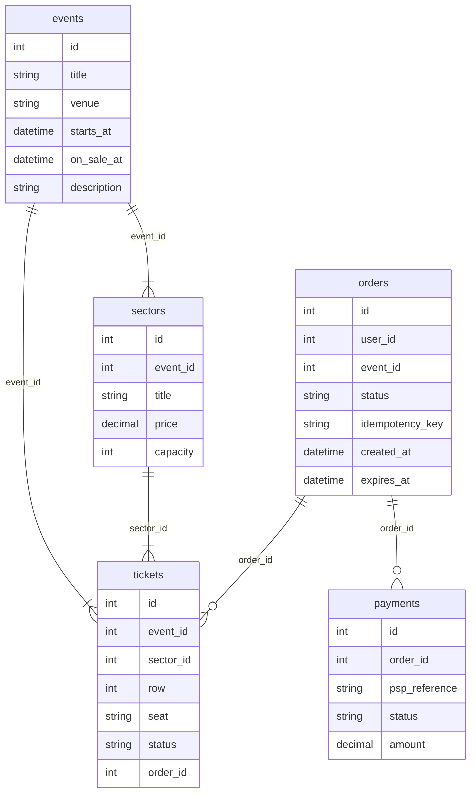
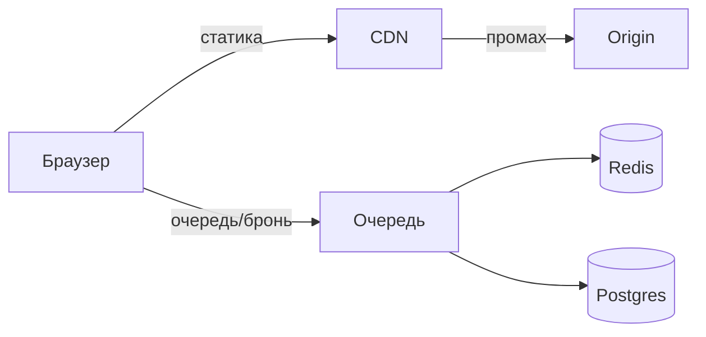
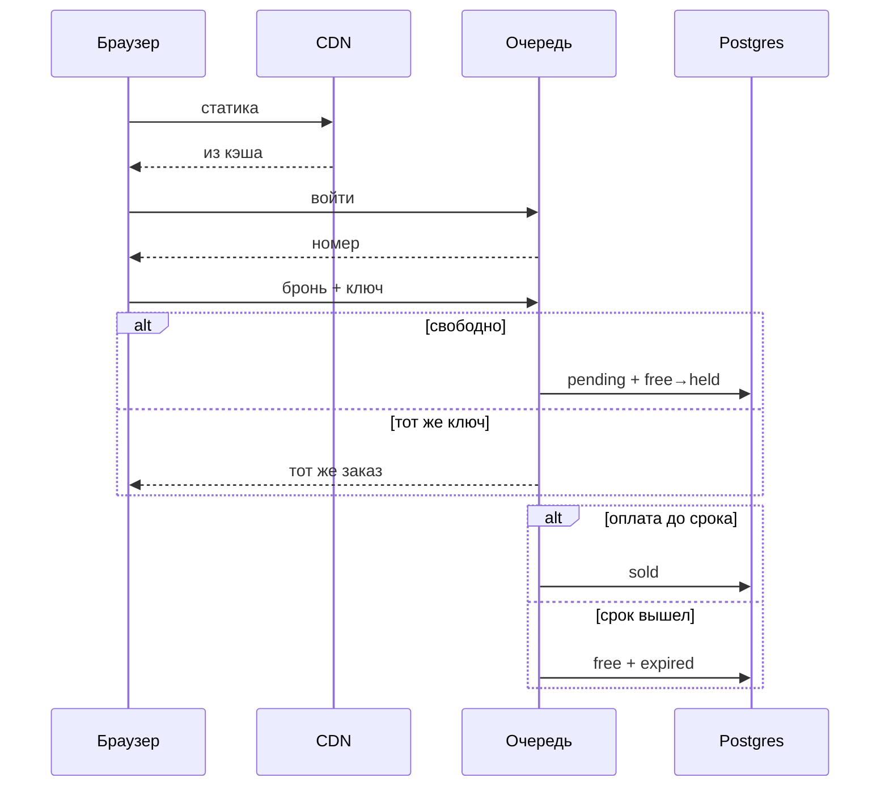

# Лабораторная работа №1

Работа 1. Путь чтения: страница события
Вопрос работы. На одной странице соседствуют описание концерта, которое не менялось три месяца, и счётчик «осталось 43 места», который устаревает за секунду. Как кэшировать страницу, у которой разные части требуют разной свежести?
1.1. Покупатель получил билет с надписью «ложа» — без мест и количества гостей. Ответьте в схеме данных: что у вас единица инвентаря — место, ложа, входной билет? Что означает «осталось мест», если в зале есть и нумерованные места, и ложи, и фан-зона без рассадки? Покажите, как ваша модель делает невозможной ситуацию «купил, а что купил — непонятно».
1.2. Сайт лёг в первые минуты продаж. Что видит пользователь, пришедший в 12:00:00, если система не может обслужить всех: зал ожидания с номером в очереди, честная очередь, отказ с предложением вернуться? Сравните два из них и выберите, обосновав числами.

**1.1 Схема данных**

Исходная схема из задания. Место — row + seat заполнены. Ложа — row/seat пустые, один билет на сектор. Фан-зона — билеты без ряда.

Единица инвентаря:
- место: конкретное кресло
- ложа: весь сектор (в билет пишем title сектора + capacity + price)
- фан-зона: входной билет, остаток = количество free

Остаток показываем по секторам, не суммой по залу. Пустые title/capacity/price бронь не создают.

Альтернатива с отдельной таблицей лож не нужна — различие уже есть по заполненности row/seat.

**1.2 Сайт упал. Что видит пользователь**

Варианты: зал ожидания с номером / честная очередь / отказ с «вернитесь позже».

Выбрали зал ожидания с номером на user_id.
С 11:50 выдаём номер. В 12:00 указатель идёт не быстрее 500/с. Допущенному создаём pending-заказ и free→held в одной транзакции. expires_at = +15 мин. Повтор с тем же idempotency_key возвращает тот же заказ.

Альтернатива — отказ без номера. Даже 429 с Retry-After будит всех сразу. При 200к человек это 200к запросов/с на origin. Очередь держит 500/с, последний ждёт ~400 с.

Если очередь недоступна — статика открывается, новые брони не создаются. Redis потерян — номера выдаём заново, бронь без номера не проходит.

**Как кэшировать страницу с разной свежестью**

Статика (описание) — CDN, TTL 10 мин, сброс при публикации.
Полустатика (сектора + остаток по ним) — TTL 60 с.
Счётчик — 1 с, один запрос на узел CDN.

Альтернатива — один HTML каждые 30 с. Отклонена: 500 броней/с × 30 с = 15к мест ошибки.

CDN не отвечает — заранее собранная страница «продажи недоступны».

Покупка не читает кэш остатка. Место забирает только условное UPDATE.

**Расчёт (допущения)**

200к человек в 12:00, остаток раз в 2 с → 100к запросов/с.
CDN 20 узлов × 1 промах/с = 20/с, hit rate 99.98%.
Потолок записи 2000 броней/с, лимит очереди 500/с.
Дешёвые 40к / 500 = 80 с. Последний ждёт 400 с.

Два концерта делят потолок. Лимит общий.

**Инварианты**

И1: sold только из held этого order_id. UPDATE ... WHERE status = free.
И2: заказ + билеты одной транзакцией.
И3: expires_at +15 мин, раз в секунду просроченные pending → free + expired.
И4: amount = сумма price, sold без платежа не ставится. Повтор ключа не создаёт второй payment.

