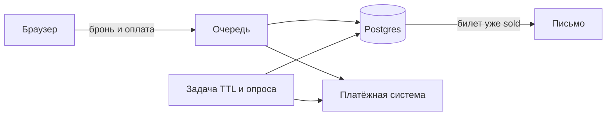
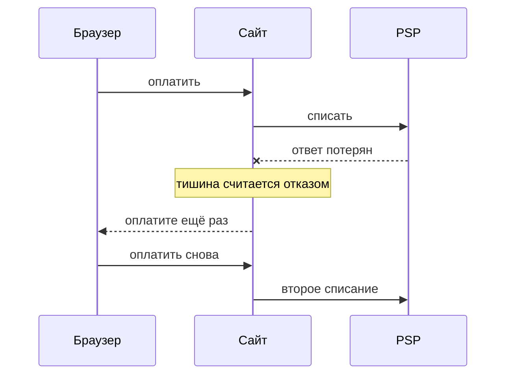
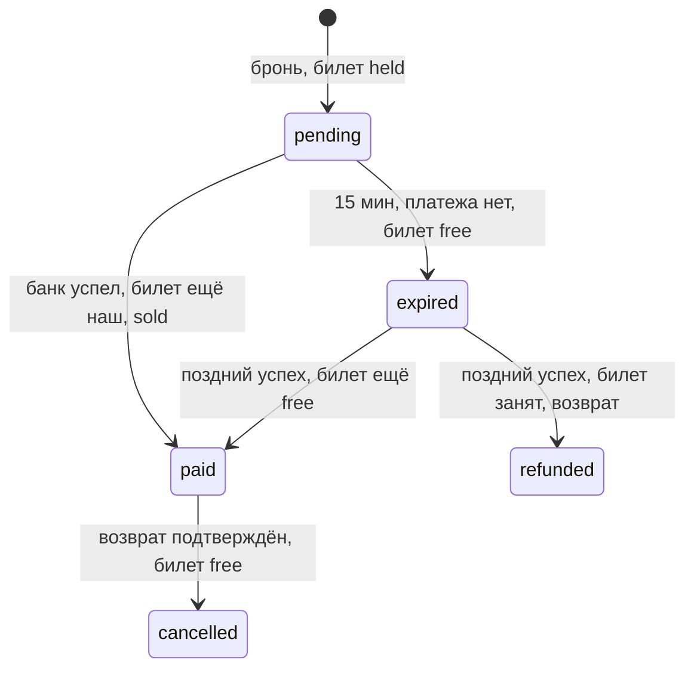

# Лабораторная работа №2. Путь записи: не продать одно место дважды

Вопрос работы. Как удержать инвариант "одно место - один владелец", когда платят двое, а платёжная система отвечает дважды или не отвечает?

Бронь устроена так же, как в работе 1. Покупатель проходит очередь. Один билет переходит из `free` в `held`, заказ создаётся в `pending`, `expires_at` ставится на 15 минут вперёд. Повтор с тем же `orders.idempotency_key` возвращает тот же заказ. Схема данных не меняется. Здесь разобрана оплата: как не списать деньги дважды и не отдать одно место двум заказам.



Место меняет только Postgres. К моменту письма строка билета уже `sold`. Письмо само статус не меняет: оно сообщает о строке, которая уже записана.

## 2.1 Повторная оплата

Части покупателей после успешной оплаты пришли письма с просьбой оплатить билет ещё раз. Ниже последовательность, в которой сайт решил, что оплаты не было, и механизм, который не даёт создать второе списание.

Покупатель нажимает оплату. Сайт отправляет списание в банк. Ответ банка теряется по дороге. Сайт не видит подтверждения и считает тишину отказом. Покупателю уходит письмо "оплатите ещё раз". Он платит снова, и в банк уходит второе списание. Потерянный ответ сам по себе сайт не путает: подтверждения у него действительно нет. Ломается следующий шаг, когда повтор создаёт новый платёж вместо того, чтобы вернуть первый.



Предлагаемый вариант. Строка `payments` пишется до вызова банка: статус `pending`, сумма `amount` и `order_id`. Вторая строка на тот же заказ не вставляется. Повтор с тем же `orders.idempotency_key` возвращает уже созданную строку, и второй вызов в банк не уходит. Пока первый платёж не получил итоговый статус, нового списания нет.

Тишина не переводит платёж в отказ. Итоговый статус сайт узнаёт у банка по `psp_reference`. Вебхук и опрос делают одно и то же: переводят `pending` в `succeeded`, и только один раз. Потерянный ответ оставляет строку в `pending` и запускает опрос. Из этой тишины не появляется ни второе списание, ни `sold`.

Альтернатива - держать ключ только на кнопке и не писать строку в базу до ответа банка. После таймаута сайт уже не видит первый платёж и на повторном нажатии создаёт новый. Поэтому строка появляется раньше вызова, а ключ заказа возвращает её же.

## 2.2 Деньги списаны, бронь снята

Другие покупатели получили письмо, что бронь аннулирована, хотя деньги уже списаны.

(а) TTL резерва - 15 минут. Если к этому моменту платёж ещё не `succeeded`, билет переходит из `held` в `free`, `order_id` очищается, заказ становится `expired`. Покупатель видит, что резерв снят.

Если подтверждение приходит после этого срока, система смотрит одну строку того же билета.

- Билет снова `free` и без `order_id`. Условный `UPDATE` забирает его: заказ становится `paid`, билет `sold`.
- Запрос обновил 0 строк. Место уже у другого заказа. Делается полный возврат, `paid` не ставится, второй билет не выдаётся.

(б) О списании система узнаёт двумя путями. Основной путь - вебхук банка. Если вебхук не пришёл, задача опрашивает `payments` в статусе `pending` старше 15 секунд, в том числе у заказов `expired`. Поэтому письмо об аннулировании не отменяет уже прошедшее списание: статус всё равно будет спрошен у банка.

Мёртвый вебхук даёт до 500 запросов/с к банку. При такой нагрузке новые брони закрываются, чтобы опрос не делил поток с новыми оплатами.

(в) С уже освобождённым и, возможно, перепроданным местом нужен один заранее выбранный исход. Задание предлагает три: вернуть деньги, предложить другое место, отдать случай оператору.

Предлагаемый вариант. Сначала пытаемся забрать тот же билет, и только если он ещё `free`. Если место занято, возвращаем всю сумму и на этом останавливаемся. Другое место не ищем. Дешёвый сектор кончается за 80 секунд, и поиск соседнего ряда снова устраивает гонку за теми же местами. Ручной разбор на старте продаж не успевает: решений больше, чем операторов.

Задача TTL не трогает билет, если платёж уже `succeeded`: такой резерв должен стать `sold`, а не `free`. Оплата сама проверяет срок. Просроченный `held` она в `sold` не переводит. Чужой `held` и чужой `sold` она тоже не забирает. Единственный поздний путь в `sold` - тот же билет, уже отпущенный в `free` без владельца.

## 2.3 Билет через восемь часов

Покупательница получила билет через восемь часов после оплаты. Нужны SLO на время "оплата - билет у пользователя", метрика, по которой видно нарушение, и поведение системы, если выдача отстаёт на часы.

`sold` ставится в той же транзакции, что и `paid`. Пока транзакция не зафиксирована, покупатель не видит ни оплаты, ни билета. Письмо только уведомляет о строке, которая уже есть в кабинете. Очереди "сначала деньги, потом когда-нибудь билет" в этом пути нет.

SLO - цель, а не замер. 99% покупателей видят билет в кабинете за 2 секунды после `succeeded`. 99% писем уходят за 5 минут.

Метрика нарушения для билета - возраст заказа в статусе `paid`, у которого билет ещё не `sold`. Алерт начинается с 30 секунд: для одной транзакции это уже сбой, а не очередь. Почта считается отдельно. Алерт по письмам - p99 дольше 5 минут.

Если копятся только письма, продажи продолжаются. Возврат из-за письма не запускается, билет открывается в кабинете. Извинение за позднее письмо не подменяет билет. Новые брони останавливаются только тогда, когда не ставится сам `sold`: в этом случае обещание "оплата и билет вместе" уже нарушено.

Альтернатива - отдельный воркер, который выдаёт билет после оплаты. При 500 оплатах/с и воркере на 10 писем/с за 8 часов очередь вырастает так:

```text
(500 - 10) * 8 * 3600 = 14 112 000 писем
```

Именно эта очередь даёт билет через восемь часов. Поэтому статус билета не откладываем на воркер. Копить такую очередь система не будет, и останавливать продажи из-за почты тоже не будет.

## 2.4 Где деньги

Организатор отправлял покупателя к оператору, оператор отвечал, что деньги уже у организатора. Нужна сверка: кто источник правды о платеже и какой отчёт за минуту отвечает, где деньги покупателя.

Источник правды о списании и возврате - банк. Источник правды о месте - таблица `tickets`. Журнал проводок не заводим. Вторая книга начинает расходиться с банком, а покупателю нужен ответ по его заказу, а не ещё одна таблица.

За минуту по номеру заказа оператор собирает один отчёт: статус заказа, `amount`, статус платежа, `psp_reference` и строки билетов. Если локальный платёж ещё `pending`, тот же запрос сразу идёт в банк. Отвечать по устаревшей строке нельзя: как раз из-за этого в кейсе покупателя отправляли от организатора к оператору.

Ответов покупателю четыре.

1. Денег нет. Банк не подтвердил списание.
2. Деньги есть, и билет `sold`. Списание подтверждено, место принадлежит этому заказу.
3. Деньги есть, места нет, возврат идёт. Списание подтверждено, билет уже у другого заказа, ждём ответ банка по возврату.
4. Возврат подтверждён банком. Платёж в статусе `refunded`.

Покупателю не говорят "деньги у организатора". Перевод площадки организатору - их взаимный расчёт, это не статус платежа покупателя. Пока банк не подтвердил возврат, оператор называет третий ответ. Когда подтвердил, называет четвёртый.

Альтернатива - отдельный журнал движений: списание, возврат, перевод организатору. Для минутного ответа хватает `payments` и `tickets`. Пока строка платежа и ответ банка на месте, четвёртого источника правды не требуется.

## 2.5 Обратный путь

Билеты продолжали продаваться, когда возврат уже не работал. Ниже обратный путь: возврат покупателя, возврат организатора, возврат части заказа и возврат после отмены события. Для каждого пути - кто его начинает, что происходит с местом, что происходит с деньгами и за какое время.

Пока возвраты не подтверждаются 5 минут, новые брони закрыты. Уже оплаченные билеты остаются действительными. Иначе за эти 5 минут накопилось бы 5 * 60 * 500 = 150 000 броней, которые нечем возвращать.

Место становится `free` только после того, как банк подтвердил возврат. До этого подтверждения билет остаётся `sold`, и следующий покупатель его не берёт.



Узел `refunded` на диаграмме - статус платежа, не колонка заказа. Если поздний успех пришёл, а билет уже занят, заказ остаётся `expired`, деньги уходят в возврат. Обычный возврат переводит заказ из `paid` в `cancelled` и только потом отпускает билет в `free`.

| Сценарий | Кто инициирует | Что с местом | Что с деньгами | За какое время |
| --- | --- | --- | --- | --- |
| Возврат покупателя | Покупатель, кнопка в кабинете | `sold` переходит в `free` после подтверждения возврата | Вся `payments.amount` | 60 секунд на ответ банка |
| Возврат организатора | Организатор, батч по событию | Те же правила на каждый билет | Полный возврат каждого заказа | 80 000 / 500 = 160 с |
| Часть заказа | Покупатель, выбранные билеты | В `free` переходят только они | Сумма их `sectors.price`, не больше платежа | Те же 60 секунд |
| Отмена события | Система | Все `sold` события переходят в `free` после возврата | Возврат всем заказам `paid` | Те же 160 с на зал |

Повтор того же возврата видит платёж уже `refunded` и второй раз в банк не идёт.

Альтернатива - освободить место сразу, а деньги вернуть потом. Если возврат сорвётся, деньги останутся у площадки, а место уже будет у другого покупателя. Поэтому порядок обратный: сначала ответ банка, потом `free`.

## Инварианты

Для каждого условия ниже одна строка: чем оно удерживается, как видно нарушение и как оно чинится.

| Инвариант | Чем обеспечивается | Как видно нарушение | Как чинится |
| --- | --- | --- | --- |
| И1. У билета `sold` ровно один `order_id` | Условный `UPDATE`. В `sold` строка переходит из `held` этого заказа, пока резерв не истёк, либо из `free` без `order_id`, если это тот же билет после TTL. Чужой `held` и чужой `sold` не обновляются. При возврате в `free` поле `order_id` снимается | `sold` без заказа, или заказ этого билета не `paid` | Продажи этого события останавливаются. Строку вручную не правят |
| И2. У заказа `paid` ровно его билеты | Заказ и билет пишутся одной транзакцией. Поздний успех либо забирает тот же билет и ставит `paid`, либо не ставит `paid` | Заказ `paid` и ноль билетов с этим `order_id` | Возврат. Заказ не оставляют в `paid` |
| И3. `held` не живёт дольше TTL | Раз в секунду: срок вышел и `succeeded` ещё нет - билет `free`, заказ `expired`. Если `succeeded` уже есть, задача билет не снимает. Оплата сама не продаёт `held` старше TTL | `held` старше 16 минут | Задача TTL. Пока она не работает, оплата такой билет не продаёт |
| И4. Сумма денег равна билетам | `amount` - сумма `sectors.price` в момент строки платежа. Один `payments` на заказ. `sold` только после `succeeded`. Возврат на ту же сумму. Место становится `free` после подтверждения банка | Два платежа на заказ, `succeeded` без билета, `amount` не равен цене | Опрос банка, лишнее списание возвращается. Без платежа `sold` не ставится |

Потерянный ответ оплаты оставляет `pending` и запускает опрос. Нового списания и `sold` из этой тишины нет.

## Отказы

Банк молчит. Строка `pending` уже есть, второго списания нет. Статус спрашивается у банка по `psp_reference`, когда ссылка известна. До ответа банка билет в `sold` не переводится.

Задача TTL встала. Оплата не продаёт просроченный `held`. Алерт ставится на `held` старше 16 минут. Снимает такой резерв задача, когда она снова работает, и только если `succeeded` ещё нет.

Почта встала. Билет в кабинете на месте, продажа идёт. Возврат из-за писем не запускается.

Postgres недоступен. Новая бронь и переход в `sold` не подтверждаются. Без записи в базу оплата не считается завершённой.

Возвраты молчат 5 минут. Новые брони закрыты. Уже оплаченные билеты остаются `sold`, пока банк не подтвердит возврат.

## Расчёт

Те же допущения, что в работе 1. Лимит записи 500/с, потолок 2000/с. Дешёвых мест 40 000, зал до 80 000. Резерв 15 минут. Оценка 4 мс на транзакцию и 20 соединений не замерена, поэтому в расчёте её нет.

Повтор оплаты упирается в строку `payments`, записанную до вызова банка. Второе списание на тот же заказ равно 0.

Если вебхук мёртв, опрос даёт до 500 запросов/с к банку. При этом потоке новые брони закрываются.

Билет в кабинете: цель 2 секунды после `succeeded`, потому что `sold` пишется в той же транзакции. Письмо: цель 5 минут. Отдельный воркер на 10 писем/с при потоке 500 оплат/с за 8 часов копит (500 - 10) * 8 * 3600 = 14 112 000 писем. Этот путь не используем.

Возврат зала: 80 000 / 500 = 160 с. Место одного заказа освобождается после ответа банка, цель ответа 60 секунд. Пока возвраты молчат 5 минут, новые брони закрыты: иначе 5 * 60 * 500 = 150 000 броней останутся без возврата.
